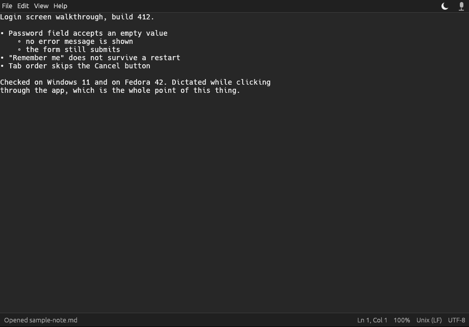

# Voice Notepad

A single-window text editor that looks and behaves like Windows Notepad, with
local speech-to-text behind one mic button. You narrate while you work, and
your words appear in the document as you speak, at the cursor.

The recogniser is NVIDIA Parakeet, a *streaming* model: audio goes in a chunk
at a time and text comes back as it is recognised, continuously, so dictation
reads as flowing prose rather than disconnected phrases.

Nothing leaves the machine. The speech model is downloaded once on first run
and everything after that is offline.



## Installing on Windows

Download `VoiceNotepad-2.0.1-Setup.exe` from the
[latest release](https://github.com/LostMachinist-Dev/VoiceNotepad/releases/latest)
and run it. Windows will warn you about it first - it is not code-signed yet,
so click **More info** and then **Run anyway**. (More on that
[below](#sharing-it-with-other-people).)

Then click through the installer. It installs for your
user only, so Windows will not ask for an administrator password. When it
finishes, Voice Notepad is in the Start menu.

The first time you open it, it downloads the speech model and shows a
progress bar. The recommended model is 2.4 GB, so give it a few minutes; you
can type while it downloads, and there is a much smaller one in Settings if
you would rather. After that it never uses the network again.

There is also `VoiceNotepad-2.0.1-portable.zip` if you would rather not
install anything: unzip it and run the exe. Keep `onnxruntime.dll` in the same
folder - the program will not start without it.

## Installing on Linux

There is no Linux package yet; build it from source. It takes one command
once the prerequisites under [Building it](#building-it) are in place:

```sh
git clone https://github.com/LostMachinist-Dev/VoiceNotepad.git
cd VoiceNotepad
./scripts/install-linux.sh      # everything goes under ~/.local, no root needed
./scripts/uninstall-linux.sh    # puts it back
```

Then run `voice-notepad [file]`, or pick Voice Notepad out of the application
menu.

One thing to know: **the system-wide hotkeys need an Xorg session.** Wayland
deliberately does not let an application claim keys system-wide, so under
Wayland the hotkeys work while the Voice Notepad window has focus but not
while another program does. The app detects this and says so in the status bar
and in Settings. Log in to an Xorg session if you need them everywhere, or use
the mic button.

## Using it

### Talking

| What | How |
| --- | --- |
| Start or stop listening | `Ctrl+Alt+Space`, or click the mic button |
| New bullet | ``Ctrl+` `` |

Both hotkeys work system-wide, so they still work while another program has
focus. That is the point: you can be clicking around the app you are testing
and still start, stop and punctuate your notes without switching windows.

The mic button is grey when paused and red when listening, and a small red dot
shows at the right of the status bar while it is listening.

Text streams in as you speak. The phrase in progress keeps being rewritten as
the transcription firms up, so you can read along; when you pause, it settles
and stops moving.

### Bullets

Bullets only ever appear when you press ``Ctrl+` ``. A pause in speech never
creates one.

- ``Ctrl+` `` starts a bullet at the cursor.
- `Tab` on a bullet line pushes it one level deeper; `Shift+Tab` pulls it back.
- ``Ctrl+` `` on a sub-bullet starts the next bullet at that same level.
- `Enter` on an empty bullet removes the marker.
- Levels cycle `•`, `◦`, `▪` as you nest, and nest as deep as you like.

If you just start talking with no bullet, the words go in as ordinary text.

### Getting the text out

Copy, Cut, Copy All and Save all convert what is on screen to markdown: a dash
for each bullet, four spaces of indentation per level, plain text otherwise.
No timestamps, no speaker labels, no segment markers, anywhere. It pastes
straight into an LLM.

`Edit > Copy All as Markdown` (`Ctrl+Shift+C`) takes the whole note in one go.

So this on screen:

```
Testing the login screen.
• Password field accepts empty input
    ◦ no error message shown
```

copies as this:

```
Testing the login screen.
- Password field accepts empty input
    - no error message shown
```

### Speed and the two models

Transcription runs on the CPU, a chunk of audio at a time. What matters is
whether a chunk is recognised faster than it takes to say, and on a modern
desktop the recommended model manages it about four times over.

| Model | Size | Notes |
| --- | --- | --- |
| Nemotron streaming (English) | 2.4 GB | The default. Punctuation and capitals. |
| Realtime EOU | 483 MB | Far smaller and faster, but writes **no punctuation and no capital letters** - just lowercase words. |

Switch in Settings. If dictation lags behind your speech on a slower machine,
that is the lever to pull.

### Settings

Right-click the mic button, or `View > Settings`. You can change the theme,
the speech model, the microphone, and both hotkeys. Changing the model
downloads it if it is not already there.

Settings live in `%APPDATA%\VoiceNotepad\config\config.json` on Windows and
`~/.config/voicenotepad/config.json` on Linux.

### The rest of the menus

File has New, Open, Save, Save As and Exit. Edit has Undo, Redo, Cut, Copy,
Paste, Delete, Copy All as Markdown, Select All and Find. View has the zoom
controls, Word Wrap and Settings. The shortcuts are Notepad's.

The theme follows Windows' light or dark setting; the sun/moon button next to
the mic flips it.

## Building it

Rust 1.82 or newer. On Linux you also need the ALSA headers, which cpal binds
to for microphone capture:

```sh
sudo apt install libasound2-dev     # Debian, Ubuntu, Mint
sudo dnf install alsa-lib-devel     # Fedora
```

Then:

```sh
cargo build --release               # a native build for the machine you are on
cargo test                          # all of the tests
cargo test --no-default-features    # just the logic, no audio or GPU needed
```

The Windows build is cross-compiled from Linux, which needs the mingw-w64
toolchain (`sudo apt install mingw-w64`) and, for the installer, NSIS. The
scripts fetch what else they need:

```sh
./scripts/build-windows.sh          # just the exe
./scripts/build-installer.sh        # exe + installer, into dist/
./scripts/package-release.sh        # all three release files + SHA256SUMS
```

[HANDOFF.md](HANDOFF.md) covers the architecture, why ONNX Runtime is linked
one way on Linux and another on Windows, and the build problems worth not
rediscovering.

## Sharing it with other people

Send them `VoiceNotepad-2.0.1-Setup.exe` and nothing else. It is a single
file - the support DLL is packed inside it and only appears on their disk when
they install.

Expect Windows to warn about it. An unsigned program from an unknown publisher
gets a blue "Windows protected your PC" screen; the way past it is **More
info** then **Run anyway**, which is worth telling people in advance.

The only real fix is a code-signing certificate, which costs money every year
and buys nothing except the absence of that warning. `scripts/sign-windows.sh`
is already written and wired into the build, so signing is one certificate
away. **If enough people find this useful, I will pay for one.** Until then,
the SHA256 checksums on each release let you verify you got what I built.

## Reporting bugs

Open an issue: <https://github.com/LostMachinist-Dev/VoiceNotepad/issues>.

The single most useful thing you can include is **Help > About > Copy
details**, which puts the version, the build target, your platform and the
model and settings paths on the clipboard. Paste that into the issue along
with what you did and what happened instead.

If the app crashed, there is a log next to the settings file -
`%APPDATA%\VoiceNotepad\config\voice-notepad.log` on Windows,
`~/.config/voicenotepad/voice-notepad.log` on Linux. The last few lines are
usually the interesting part.

Things already known and not worth reporting are in
[TASKS.md](TASKS.md) under *Next*; the big ones are that global hotkeys cannot
work under Wayland, and that Find has no Replace or Find Previous yet.

## Licence

The code is MIT. See [LICENSE](LICENSE).

That covers this program only. The speech models are **not** part of it and
are not redistributed here - the app downloads them from
[altunenes/parakeet-rs](https://huggingface.co/altunenes/parakeet-rs) on
Hugging Face on first run. They are NVIDIA Parakeet models and carry their own
terms, which are on that page. Check them before you use this commercially.
